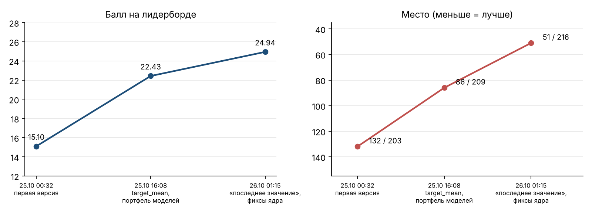
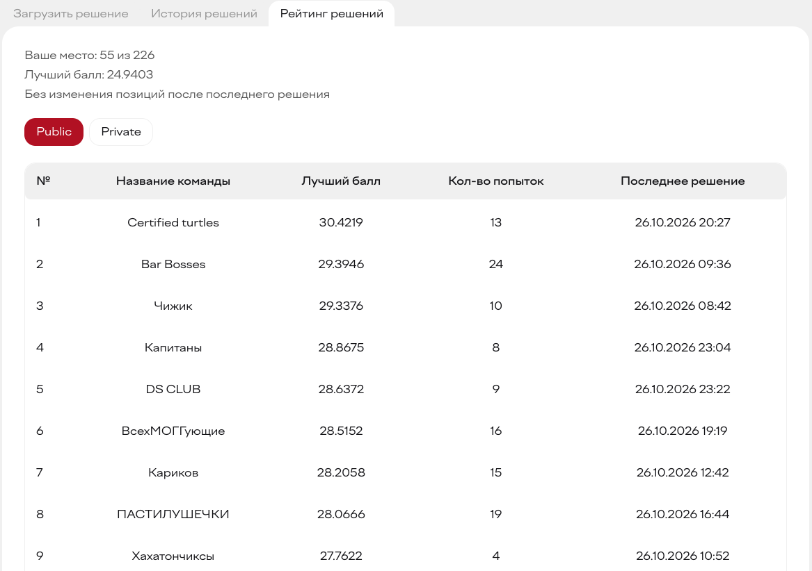
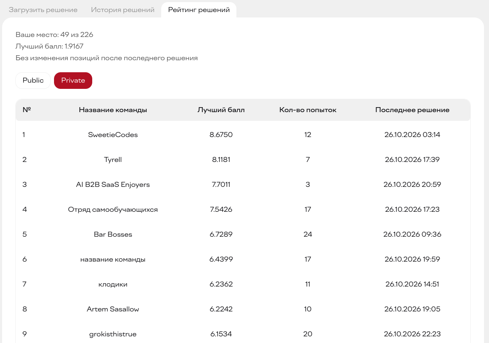
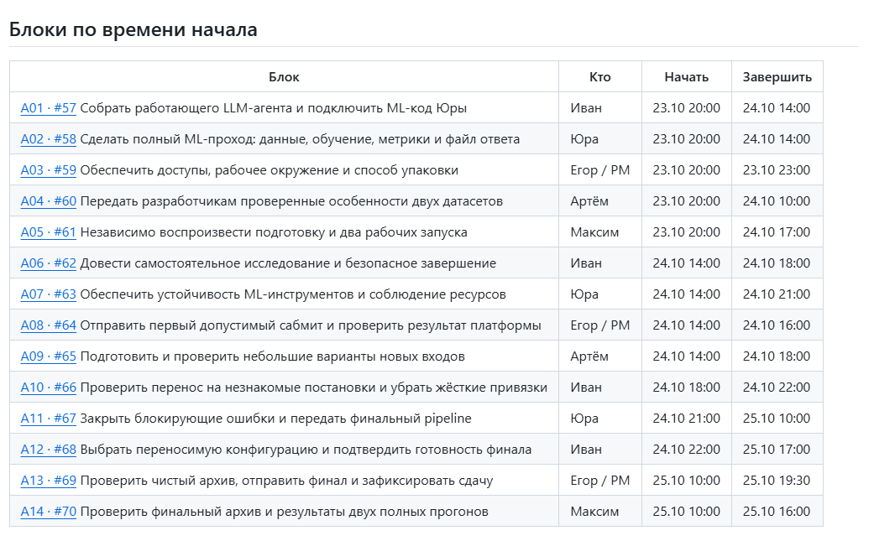
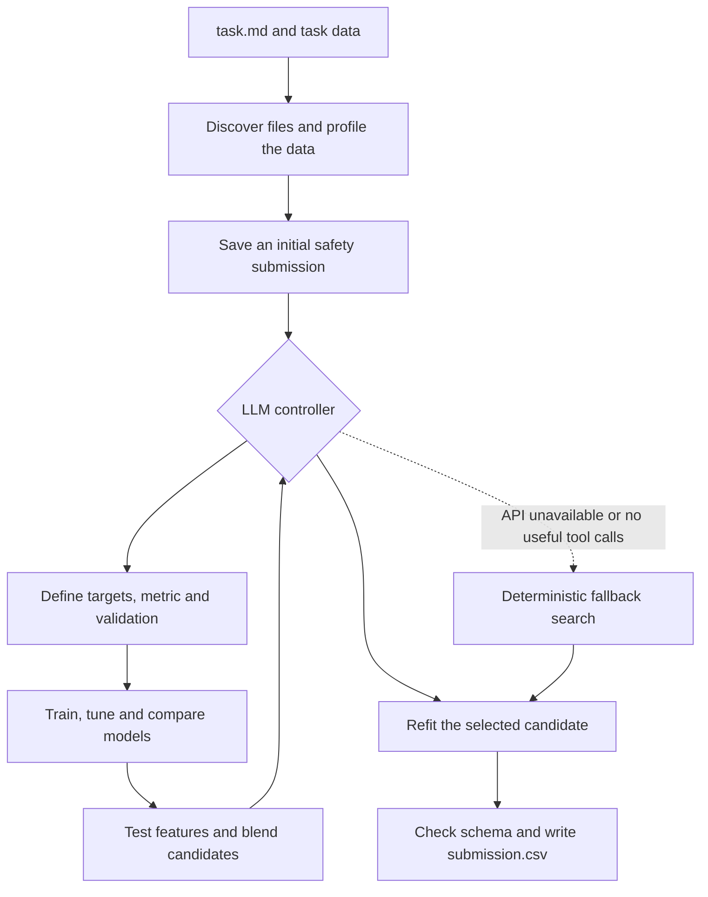
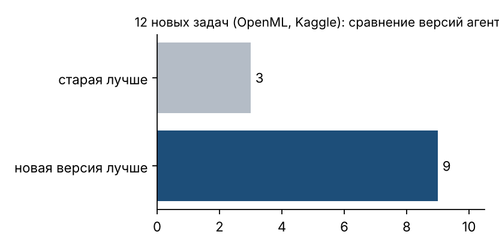

**English** | [Русский](README.ru.md)

# Alfa AutoML Agent

**From a task description to a validated submission, with an LLM directing the experiments.**

A team project from the **Alfa-Future Hackathon 2026**, built around an LLM-controlled experiment loop and a reproducible submission package. The agent reads `task.md`, inspects the supplied data, chooses a task definition and validation strategy, trains competing models, and writes `submission.csv`.

**49 / 226 private leaderboard · 55 / 226 public leaderboard · Python 3.12 · CPU only**

## Results

| Measure | Result |
| --- | --- |
| Final private rank | **49th out of 226 teams** |
| Final public rank | **55th out of 226 teams** |
| Public score across three submissions | **15.10 → 22.43 → 24.94** |
| Historical comparison on 12 external datasets | The newer version performed better on **9 of 12** tasks |

The submission history below shows the team's progress during the competition. Its intermediate ranks are snapshots; the final standings are shown in the platform screenshots.



<details>
<summary>Final leaderboard screenshots</summary>

**Public leaderboard — 55th of 226 teams**



**Private leaderboard — 49th of 226 teams**



</details>

The improvements combined entity-level target statistics, a broader model portfolio, deeper XGBoost configurations, temporal features and fixes to grouped validation. These scores were recorded during the competition.

## My contribution

I was the **PM for a five-person team**. I broke the hackathon requirements into 14 tasks, assigned owners and set checkpoints. I owned environment readiness and coordinated submission prep.

My work in the repository includes:

- **Environment diagnostics:** `tools/check_environment.py` checks Python and pinned dependencies, with an optional explicit API check.
- **Submission packaging:** `tools/build_submission.py` builds a deterministic ZIP, checks the platform's flat file layout, preserves the official requirements and reports its SHA256.
- **Release checks:** `tests/test_release_tools.py` covers archive contents, syntax, common credential patterns, filename collisions, clean extraction and preservation of a previous archive after a failed build.
- **Clean ZIP smoke runs:** `tools/smoke_submission.py` unpacks the real submission into temporary task directories and verifies regression and multiclass predictions without API access or source-tree imports.
- **Team workflow:** the original 14 delivery blocks, role assignments, platform constraints and submission rules remain in `docs/` and `planning/`.

This was a five-person effort. Ivan developed the LLM controller and orchestration; Yura developed the ML pipeline and its reliability; Artyom worked on data analysis and input variations; Maxim performed independent checks; I coordinated delivery and prepared the environment and packaging workflow. The model results above belong to the team.

[Team plan](docs/EXECUTION_ORDER.md) · [Environment and packaging](docs/tasks/current/A03.md) · [First submission](docs/tasks/current/A08.md) · [Final delivery](docs/tasks/current/A13.md)



## How the agent works



The LLM uses the OpenAI SDK against an OpenAI-compatible endpoint. Its decisions drive real tool calls: task setup, model parameters, validation, feature experiments and model selection. Tool results feed back into the conversation so the next experiment can respond to measured performance.

| Tool | Purpose |
| --- | --- |
| `set_task` | Select targets, identifiers, task type, metric and prediction format |
| `evaluate` | Train and validate a model configuration |
| `tune` | Explore configurations within the remaining budget |
| `add_features` | Evaluate proposed feature transformations |
| `blend` | Combine compatible candidates using out-of-fold predictions |
| `finalize` | Refit a candidate and write its predictions |
| `finish` | End the research loop |

CatBoost, LightGBM and XGBoost form the model portfolio. The pipeline handles regression, binary and multiclass classification, label or probability outputs, and supported multiple-target schemas. Validation can account for stratification, groups and time. Target names and submission columns are inferred from the supplied task materials.

The runtime saves an early answer, reserves time for final training and keeps a previously written answer if a later experiment fails. The fallback uses the same ML tools when the LLM cannot complete the loop.

## Run locally

Use **Python 3.12**. The official dependency list is kept in [reference/requirements.txt](reference/requirements.txt).

```bash
python3.12 -m venv .venv
source .venv/bin/activate
python -m pip install -r reference/requirements.txt
cp .env.example .env
# Fill in the endpoint, key and model supplied for your environment.
python solution.py /absolute/path/to/task/task.md
```

On Windows, use PowerShell:

```powershell
py -3.12 -m venv .venv
& .\.venv\Scripts\python.exe -m pip install -r reference/requirements.txt
Copy-Item .env.example .env
& .\.venv\Scripts\python.exe -X utf8 solution.py C:\tasks\example\task.md
```

Pass the **path to `task.md`**, not just its directory. Data files can live in subdirectories referenced by the task. The result is written beside `task.md`.

| Setting | Meaning | Default |
| --- | --- | --- |
| `OPENAI_API_KEY` | Credential for the supplied LLM endpoint | Required for LLM mode |
| `OPENAI_BASE_URL` | OpenAI-compatible endpoint | Required for LLM mode |
| `OPENAI_MODEL` | Model identifier supplied for the environment | Built-in competition model if omitted |
| `AGENT_TIME_LIMIT` | Total runtime budget, in seconds | `10800` |
| `AGENT_SAFETY_S` | Time reserved for final work and exit | `900` |
| `AGENT_MAX_STEPS` | Maximum LLM dialogue steps | `40` |
| `AGENT_LLM` | Set to `off` for an offline fallback run | `on` |

For a short offline smoke run, set `AGENT_LLM=off`, `AGENT_TIME_LIMIT=300` and `AGENT_SAFETY_S=45` in the local `.env`. Keep the reserve smaller than the total budget. Offline mode checks the ML path; it does not exercise the live LLM.

## Verify and package

With the environment activated:

```bash
python tools/check_environment.py --full
python -m unittest discover -s tests -v
python tools/build_submission.py
python tools/build_submission.py --check artifacts/solution.zip
python tools/smoke_submission.py
python tools/build_submission.py --check artifacts/solution.zip --extract-to tmp/clean-release
```

Use a new extraction directory for each clean check. Copy the extracted files into a separate task directory containing `task.md` and its data, then run the platform command there:

```bash
python3 solution.py task.md
```

The ZIP includes only root-level Python modules and the exact official `requirements.txt`. Documentation, tests, datasets, model files, local settings and logs stay outside it. The builder checks syntax, structure, size and common credential patterns. The smoke tool separately checks runtime imports and learned predictions on two small synthetic tasks; it does not measure performance on the competition data.

Tests use synthetic data and scripted or mocked LLM responses. They cover the controller, preprocessing, task and output schemas, metrics, validation, model fitting, feature experiments, ensembling and packaging, without requiring live API access.

Tests requiring the original public datasets are skipped when those files are absent. Grouped-validation correctness is always checked; set `ML_GROUP_SPLIT_MAX_SECONDS` to add a host-specific timing limit for its 50,000-row benchmark.

Use `tests/external_tasks.py` for experiments on unfamiliar datasets. It downloads the data during preparation and keeps it outside Git. The chart below shows the earlier 12-task comparison.



## Constraints and limitations

The competition environment allowed **8 CPU cores, 32 GB RAM, 30 GB disk and up to 3 hours per task**, without a GPU. Submissions were limited to **100 MB**, and only root-level `.py` files and the supplied `requirements.txt` were copied into the task environment. The solution cannot install dependencies or download datasets during evaluation.

Training uses the supplied task data. The implementation focuses on supervised tabular problems; ranking, unsupervised learning and arbitrary output schemas are not established capabilities. Results depend on the task description, validation choice and available budget. The initial safety submission can contain constant predictions.

Offline checks cover the local ML workflow. Live API compatibility and Linux platform acceptance require separate runs; the leaderboard scores above come from the competition.

## Repository guide

| Path | Contents |
| --- | --- |
| `solution.py` | Entry point, budget management, fallback and final output |
| `agent_llm.py` | LLM client, tool-calling loop and conversation compaction |
| `agent_tools.py` | Experiment session and agent-facing tools |
| `ml_*.py` | Data loading, profiling, schemas, validation, models and output handling |
| `tools/` | Environment diagnostics, ZIP builder and clean smoke runs |
| `tests/` | ML, agent and release checks; external-task harness |
| `assets/` | Historical charts and platform screenshots |
| `reference/` | Organizer baseline, dependency list and public task descriptions |
| `docs/`, `planning/` | Original team workflow, delivery blocks and competition materials |

The planning documents retain the original working language and pre-implementation milestones. For the current entry point and commands, use this README and the [runbook](docs/RUNBOOK.md).
