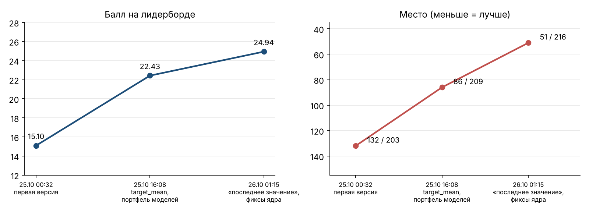
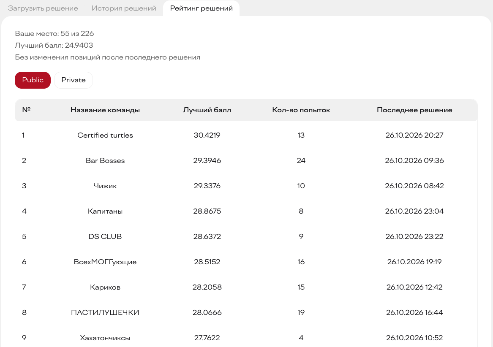
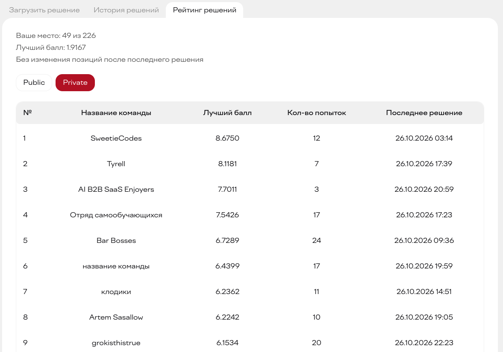
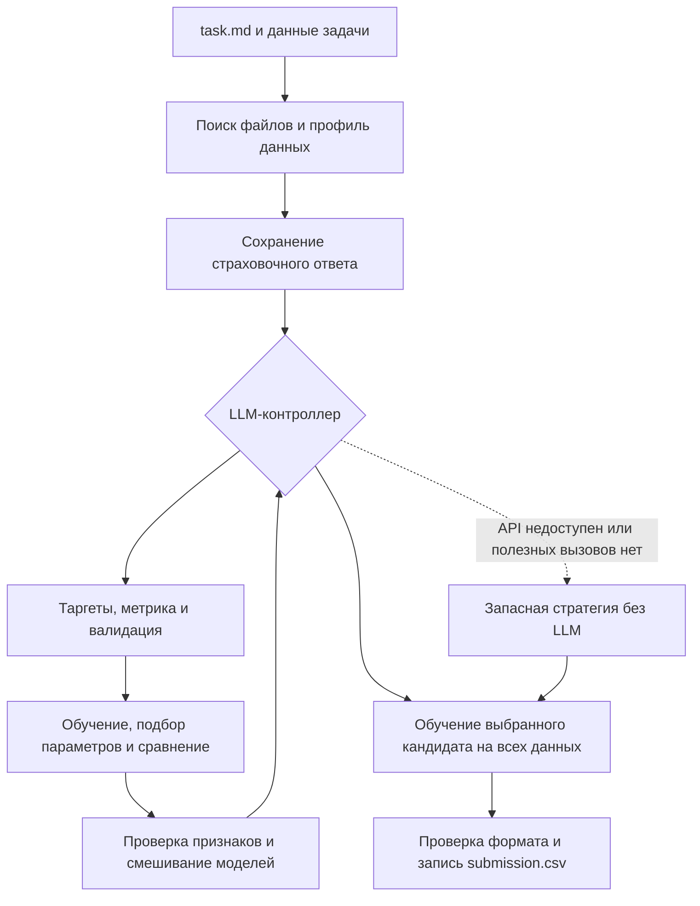
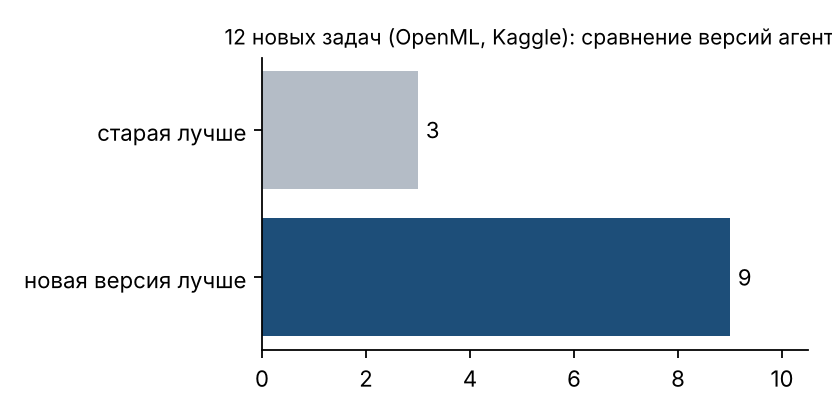

[English](README.md) | **Русский**

# Alfa AutoML Agent

**От условия задачи до проверенного файла ответа — LLM управляет экспериментами.**

Командный проект **Альфа-Будущее Хакатона 2026**: автономное машинное обучение на табличных данных и воспроизводимый процесс сдачи решения. Агент читает `task.md`, исследует данные, выбирает постановку и схему валидации, сравнивает модели и сохраняет `submission.csv`.

**49 / 226 на приватном лидерборде · 55 / 226 на публичном · Python 3.12 · Только CPU**

## Результаты

| Показатель | Результат |
| --- | --- |
| Итоговое место на приватном лидерборде | **49-е из 226 команд** |
| Итоговое место на публичном лидерборде | **55-е из 226 команд** |
| Балл за три отправки | **15.10 → 22.43 → 24.94** |
| Сравнение версий на 12 внешних датасетах | Новая версия показала лучший результат в **9 из 12** задач |

График показывает прогресс команды во время соревнования. Промежуточные места отражают рейтинг на момент отправки; итоговые позиции видны на скриншотах платформы.



<details>
<summary>Скриншоты итогового рейтинга</summary>

**Публичный лидерборд — 55-е место из 226 команд**



**Приватный лидерборд — 49-е место из 226 команд**



</details>

Прирост дали статистики таргета по сущностям, расширение набора конфигураций моделей, более глубокие деревья XGBoost, временные признаки и исправления групповой валидации. Здесь приведены результаты соревнования, полученные во время хакатона.

## Мой вклад

Я занимался **координацией проекта, подготовкой окружения и сдачей решения**: переводил требования соревнования в рабочий план, распределял ответственность и контрольные точки, готовил среду и воспроизводимую сборку.

В репозитории сохранились конкретные результаты этой работы:

- **Проверка окружения:** `tools/check_environment.py` сверяет Python и закреплённые версии зависимостей. Проверка API включается отдельно.
- **Сборка решения:** `tools/build_submission.py` создаёт детерминированный ZIP, проверяет плоскую структуру файлов, сохраняет официальный requirements без изменений и выводит SHA256 архива.
- **Проверки перед сдачей:** `tests/test_release_tools.py` проверяет состав архива, синтаксис, типичные форматы ключей, совпадения имён файлов, распаковку в чистый каталог и сохранение предыдущего архива при неудачной сборке.
- **Запуск из чистого ZIP:** `tools/smoke_submission.py` распаковывает сдаваемый архив во временные каталоги и проверяет предсказания для регрессии и многоклассовой классификации без API и импортов из исходного репозитория.
- **Работа команды:** в `docs/` и `planning/` остались исходные 14 блоков работ, роли, ограничения платформы и правила отправки.

Проект делали пять человек. Иван разработал LLM-контроллер и управление запуском; Юра — ML-pipeline и его устойчивость; Артём занимался анализом данных и вариантами новых входов; Максим проводил независимые проверки. Я координировал сдачу и готовил окружение и сборку. Результаты моделей — общий результат команды.

## Как работает агент



LLM вызывается через OpenAI SDK и OpenAI-совместимый API. Её решения запускают реальные действия: определение задачи, выбор параметров, валидацию, эксперименты с признаками и выбор модели. Результаты инструментов возвращаются в диалог и помогают выбрать следующий эксперимент.

| Инструмент | Назначение |
| --- | --- |
| `set_task` | Выбрать таргеты, идентификаторы, тип задачи, метрику и формат предсказаний |
| `evaluate` | Обучить и проверить конфигурацию модели |
| `tune` | Подобрать конфигурации в оставшемся бюджете |
| `add_features` | Оценить предложенные преобразования признаков |
| `blend` | Смешать совместимых кандидатов по предсказаниям out-of-fold |
| `finalize` | Дообучить кандидата и сохранить предсказания |
| `finish` | Завершить исследование |

В набор моделей входят CatBoost, LightGBM и XGBoost. Поддерживаются регрессия, бинарная и многоклассовая классификация, ответы в виде меток или вероятностей и совместимые схемы с несколькими таргетами. Валидация может учитывать стратификацию, группы и время. Названия таргетов и колонок ответа определяются по материалам конкретной задачи.

Агент сохраняет ранний ответ, оставляет время на финальное обучение и сохраняет уже записанный результат при сбое следующего эксперимента. Если LLM не довела исследование до результата, запасная стратегия работает с теми же ML-инструментами.

## Локальный запуск

Нужен **Python 3.12**. Официальный список зависимостей находится в [reference/requirements.txt](reference/requirements.txt).

```bash
python3.12 -m venv .venv
source .venv/bin/activate
python -m pip install -r reference/requirements.txt
cp .env.example .env
# Укажите выданные для вашего окружения адрес API, ключ и модель.
python solution.py /absolute/path/to/task/task.md
```

В Windows используйте PowerShell:

```powershell
py -3.12 -m venv .venv
& .\.venv\Scripts\python.exe -m pip install -r reference/requirements.txt
Copy-Item .env.example .env
& .\.venv\Scripts\python.exe -X utf8 solution.py C:\tasks\example\task.md
```

Передавайте **путь к файлу `task.md`**, а не только к каталогу. Данные могут находиться во вложенных папках, указанных в условии. Результат сохраняется рядом с `task.md`.

| Настройка | Значение | По умолчанию |
| --- | --- | --- |
| `OPENAI_API_KEY` | Ключ доступа к выданному API | Нужен для режима с LLM |
| `OPENAI_BASE_URL` | Адрес OpenAI-совместимого API | Нужен для режима с LLM |
| `OPENAI_MODEL` | Идентификатор модели для окружения | Встроенная модель соревнования, если переменная не задана |
| `AGENT_TIME_LIMIT` | Общий бюджет времени в секундах | `10800` |
| `AGENT_SAFETY_S` | Запас времени на финальную работу и выход | `900` |
| `AGENT_MAX_STEPS` | Максимальное число шагов диалога с LLM | `40` |
| `AGENT_LLM` | Значение `off` включает запасную стратегию без API | `on` |

Для короткой офлайн-проверки задайте в локальном `.env`: `AGENT_LLM=off`, `AGENT_TIME_LIMIT=300` и `AGENT_SAFETY_S=45`. Запас должен быть меньше общего бюджета. Такой запуск проверяет ML-pipeline без обращения к реальной LLM.

## Проверка и сборка

В активированном окружении выполните:

```bash
python tools/check_environment.py --full
python -m unittest discover -s tests -v
python tools/build_submission.py
python tools/build_submission.py --check artifacts/solution.zip
python tools/smoke_submission.py
python tools/build_submission.py --check artifacts/solution.zip --extract-to tmp/clean-release
```

Для каждой проверки используйте новый каталог распаковки. Скопируйте распакованные файлы в отдельный каталог с `task.md` и данными, затем выполните команду платформы:

```bash
python3 solution.py task.md
```

В ZIP попадают только корневые Python-модули и точная копия официального `requirements.txt`. Документация, тесты, датасеты, модели, локальные настройки и логи в архив не входят. Сборщик проверяет синтаксис, структуру, размер и типичные форматы ключей. Отдельный короткий запуск проверяет импорты и предсказания моделей на двух маленьких синтетических задачах; качество на данных соревнования он не измеряет.

Тесты используют синтетические данные и сценарные или имитированные ответы LLM. Они проверяют контроллер, предобработку, постановку и формат ответа, метрики, валидацию, обучение, эксперименты с признаками, ансамбли и сборку без доступа к реальному API.

Проверки, которым нужны исходные публичные датасеты, пропускаются при отсутствии этих файлов. Корректность групповой валидации проверяется всегда. Чтобы добавить ограничение времени для её проверки на 50 000 строках, задайте `ML_GROUP_SPLIT_MAX_SECONDS` под конкретный компьютер.

Скрипт `tests/external_tasks.py` предназначен для отдельных экспериментов на новых задачах. При подготовке он скачивает датасеты и хранит их вне Git. График ниже показывает сравнение версий на 12 задачах, выполненное ранее.



## Ограничения

На соревновании на одну задачу выделялись **8 ядер CPU, 32 GB RAM, 30 GB диска и до 3 часов**, без GPU. Размер сдаваемого ZIP ограничивался **100 MB**. В окружение задачи копировались только корневые `.py` и предоставленный `requirements.txt`. Во время оценки решение не может устанавливать зависимости или скачивать датасеты.

Модели обучаются на данных задачи. Реализация рассчитана на табличные задачи обучения с учителем; поддержка ранжирования, обучения без учителя и произвольных форматов ответа не подтверждена. Результат зависит от описания, схемы валидации и доступного времени. Страховочный ответ нужен на случай сбоев и может содержать константные предсказания.

Рейтинги и результаты на внешних датасетах отражают проведённые эксперименты. Локальные офлайн-проверки не подтверждают совместимость с реальным API, приёмку в Linux-окружении платформы или повторение этих результатов.

## Структура репозитория

| Путь | Содержимое |
| --- | --- |
| `solution.py` | Точка входа, бюджет времени, запасная стратегия и финальный ответ |
| `agent_llm.py` | Клиент LLM, цикл вызовов инструментов и сжатие истории диалога |
| `agent_tools.py` | Состояние экспериментов и инструменты агента |
| `ml_*.py` | Загрузка и профиль данных, схемы, валидация, модели и формирование ответа |
| `tools/` | Проверка окружения, сборка ZIP и запуск из чистого архива |
| `tests/` | Проверки ML, агента и сборки; эксперименты на внешних задачах |
| `assets/` | Графики экспериментов и скриншоты платформы |
| `reference/` | Baseline организаторов, зависимости и условия публичных задач |
| `docs/`, `planning/` | Исходный план команды, блоки работ и материалы соревнования |

Плановые документы сохраняют исходный рабочий язык и этапы подготовки до появления реализации. Актуальные команды приведены здесь и в [инструкции по запуску и сборке](docs/RUNBOOK.md).
